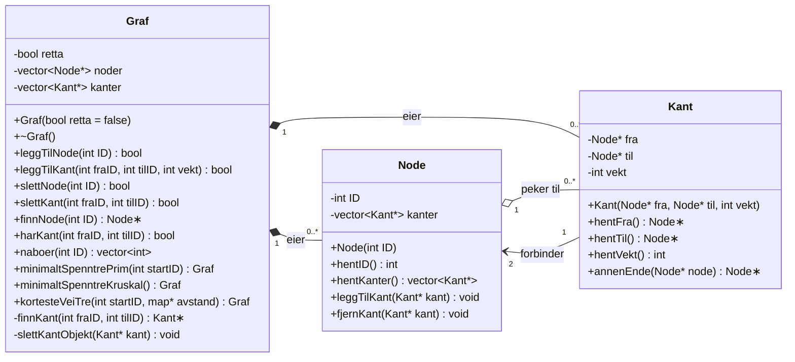

# UML-klassediagram

## Designvalg

- **Eierskap:** `Graf` eier alle `Node`- og `Kant`-objektene og sletter dem i destruktøren. `Node` og `Kant` har bare pekere som ikke eier. Dermed slettes ingenting dobbelt.
- **Uretta graf:** Én `Kant` lages, og pekeren legges i `kanter` hos *begge* noder.
- **Retta graf:** Kanten legges bare i `kanter` hos `fra`-noden. Retning styres av `Graf::retta`.
- **Del 1 til Del 2:** `Node` hadde først `vector<Node*> naboer`. I Del 2 ble denne erstattet av `vector<Kant*> kanter`. Naboer finnes nå via `Kant::annenEnde()`, eller `Graf::naboer(ID)`.
- **Kopiering:** `Graf` eier rå pekere, så kopiering er slått av (`= delete`). Grafen kan flyttes, og det brukes når algoritmene returnerer et nytt `Graf`-objekt.

## Endringer for retta grafer (krav i 3.2c)

| Funksjon | Uretta | Retta |
|---|---|---|
| `leggTilKant(a, b)` | Kanten legges hos både a og b | Kanten legges bare hos a |
| `slettKant(a, b)` | Finner kanten i begge retninger | Finner bare a→b |
| `slettNode` | Fjerner alle kanter som berører noden | Fjerner både inngående og utgående kanter (kantlisten i `Graf` brukes, siden inngående kanter ikke ligger hos noden) |
| Dijkstra | Følger alle kanter fra noden | Følger bare utgående kanter. Noder som ikke kan nås tas ikke med i treet. Resultatgrafen er retta |
| Minimalt spenntre | Prim og Kruskal | Støttes ikke (kaster `std::invalid_argument`). MST er definert for uretta grafer, mens retta grafer krever en annen algoritme (Chu-Liu/Edmonds) |
